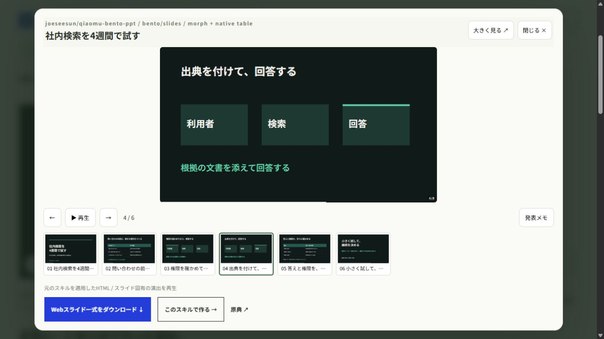

# リポジトリ別制作事例の確認記録

2026-10-14。製品仕様の正本は [PRODUCT_SPEC.md](PRODUCT_SPEC.md)、制作範囲の正本は [case-studies.json](../data/case-studies.json) と [production-ledger.json](../data/production-ledger.json)。ローカル実装と制作QAの記録であり、人による正式採用・外部公開は未実施。

## 現行の制作範囲

22リポジトリ、25冊、154枚。編集可能PPTX 10冊56枚、画像主体PPTX 1冊3枚、固有HTML 14冊95枚。元209件は作者・分類・データを保持し、原典入口を取得・棚卸し済み。残187件は未制作で、取得だけを生成成功に数えない。

各リポのCLI、MCP、指示型スキル、テンプレート、変換器を使用し、実行記録と原典ファイルのハッシュを保存している。旧共通renderer試作・自己紹介題材の試作は現行件数に含めない。

| 事例別QA記録 | 原典リポジトリ | 枚数 | 出力 |
|---|---|---:|---|
| [cafe-pptx](../examples/cases/cafe-pptx/QA.json) | hugohe3/ppt-master | 8 | 編集可能PPTX |
| [ec-monthly](../examples/cases/ec-monthly/QA.json) | hugohe3/ppt-master | 7 | 編集可能PPTX |
| [cafe-web](../examples/cases/cafe-web/QA.json) | zarazhangrui/frontend-slides | 8 | HTML |
| [git-onboarding](../examples/cases/git-onboarding/QA.json) | zarazhangrui/frontend-slides | 7 | HTML |
| [port-town](../examples/cases/port-town/QA.json) | op7418/guizang-ppt-skill | 7 | HTML |
| [knowledge-search](../examples/cases/knowledge-search/QA.json) | op7418/guizang-ppt-skill | 8 | HTML |
| [revealjs-skill](../examples/repositories/revealjs-skill/QA.json) | ryanbbrown/revealjs-skill | 6 | HTML |
| [lewis-html-ppt](../examples/repositories/lewis-html-ppt/QA.json) | lewislulu/html-ppt-skill | 8 | HTML |
| [minorun-marp](../examples/repositories/minorun-marp/QA.json) | minorun365/minorun-marp-skill | 9 | HTML |
| [neon-slides](../examples/repositories/neon-slides/QA.json) | lqshow/neon-slides | 6 | HTML |
| [office-powerpoint-mcp](../examples/repositories/office-powerpoint-mcp/QA.json) | GongRzhe/Office-PowerPoint-MCP-Server | 6 | 編集可能PPTX |
| [mck-design](../examples/repositories/mck-design/QA.json) | likaku/Mck-ppt-design-skill | 6 | 編集可能PPTX |
| [jinba-consulting](../examples/repositories/jinba-consulting/QA.json) | carnot-tech/jinba-consulting-pptx-skill | 7 | 編集可能PPTX |
| [japanese-corporate](../examples/repositories/japanese-corporate/QA.json) | gonta223/japanese-corporate-pptx-skill | 6 | 編集可能PPTX |
| [qiaomu-bento](../examples/repositories/qiaomu-bento/QA.json) | joeseesun/qiaomu-bento-ppt | 6 | HTML |
| [make-slide](../examples/repositories/make-slide/QA.json) | Kuneosu/make-slide | 8 | HTML |
| [frontend-editable](../examples/repositories/frontend-editable/QA.json) | archlizheng/frontend-slides-editable | 6 | HTML |
| [dashi-ppt](../examples/repositories/dashi-ppt/QA.json) | chuspeeism/dashi-ppt-skill | 6 | HTML |
| [codex-image-ppt](../examples/repositories/codex-image-ppt/QA.json) | ningzimu/codex-ppt-skill | 3 | 画像PPTX |
| [multiagent-ppt](../examples/repositories/multiagent-ppt/QA.json) | johnson7788/MultiAgentPPT | 4 | 編集可能PPTX |
| [knowledge-cat](../examples/repositories/knowledge-cat/QA.json) | gnipbao/knowledge-cat-ppt-skill | 5 | 編集可能PPTX |
| [seaslides](../examples/repositories/seaslides/QA.json) | touying-typ/seaslides | 5 | HTML |
| [ppt-design-skill](../examples/repositories/ppt-design-skill/QA.json) | sunchaokun/PPT-Design-Skill | 5 | 編集可能PPTX |
| [magic-slide](../examples/repositories/magic-slide/QA.json) | daniel-style/magic-slide | 5 | HTML |
| [image-to-editable](../examples/repositories/image-to-editable/QA.json) | ningzimu/image-to-editable-ppt-skill | 2 | 編集可能PPTX |

## 全ページの描画・目視

全154ページの目視確認が完了。PPTXは完成ファイルをMicrosoft PowerPointで開いた59枚のPNGとPDFを生成し、入力SVGや元HTMLだけで代替していない。各冊の描画receiptにPPTXのSHA、ページ順序と出力を記録した。HTML95枚は固有ランタイムで再生し、実表示を確認している。

今回追加したWeb7冊49枚は全ページを実ブラウザーで再生し、DOMの見出し・ページ位置を照合、実キャプチャを全頁視認した。対象はReveal.js 6枚、Lewis HTML 8枚、minorun Marp 9枚、Neon 6枚、Bento 6枚、make-slide 8枚、Frontend Editable 6枚。Dashi 6枚は別途同じく実ブラウザーで全頁を確認した。先行6冊45枚に、上表の原典別制作を追加している。新規PPTXは実ファイルのPowerPoint描画、HTMLは原典ランタイムの実表示を確認する。

画像PPTXは全3枚の生成画像とPowerPoint描画の両方を目視した。日本語本文、Gitコマンド、状態図の意味と矢印を確認。PPTXの各ページは1画像で、本文・図の個別編集はできない。画像内の日本語確認をXML上の文字検査で代替せず、別途日本語の発表者ノートを確認した。生成画像とPPTX mediaのSHA一致により、後付け文字overlayや画像の差替えを含まないことを検査する。

全ページ目視は制作担当によるレビューであり、人による正式採用を意味しない。各QA.jsonが対象ファイルと画像のSHA、レビュー範囲を保持する。再生成した場合は、その新しい出力を改めて確認する。

## 主な修正と固有条件

- Office PowerPoint MCP：原典serverへの実MCP呼出しで制作。系列凡例の重なりを解消し、原典のテキスト操作でラベルを配置した。
- Mck：原典DeckBuilder/MckEngineとS3/S4検査を使用。固定の中国語担当ラベルを日本語へ補正し、差分と元の検査結果を保存した。
- Jinba：原典HTML部品と変換器を使用。変換時の倍率に対する文字サイズ補正を記録し、ページ別講稿を改善した。
- Japanese Corporate：原典PPTXのレイアウト・文字書式を使い、native chart/tableを更新。状態色と数値ラベルの収まりを確認した。
- Dashi：schema v2の3+1案経路は原典copy validatorの制約で不成立となった記録を保持。1案経路で原典validatorを通し、派生HTML runtimeでは表示データとグラフ形状の不一致を修正。売上棒の高さ、構成比の弧長、Ring/Bar操作も確認した。原典ソースと派生差分を保持する。
- Bento：原典の固定shellを維持し、許可されたJSON payloadのみ更新。日本語化のためにshellを書き換えず、原典validatorとshell gateを使用した。
- Guizang：工程表の重なり、末尾の白文字、ページ連続操作時の旧ページ残留を修正。操作ラベルと計時を日本語化し、作用名の検査は中国語/日本語へ対応させ、他の条件は維持した。

## 自動検査と配布検証

共通検査は次で実行する。

~~~text
python tools/verify_repository_release.py
~~~

この検査は元209件の一致、リポ・冊数・枚数の対応、原典と出力のハッシュ、PNG/PPTX構造、固有HTML runtime、記録された全ページレビュー、ZIPの内容と更新一致を検査する。画像PPTXではjobs/style/state、native生成記録、原典assembler実行、画像media一致、日本語ノートと画像内日本語の目視記録を追加条件とする。失敗した初期コマンドは消さず、同一コマンドの後続成功とログのハッシュで復旧を検証する。

**最終自動検査：152項目通過、問題0件。** [実行結果](../data/release-qa.json)を保存。Jinba 7枚・Japanese Corporate 6枚のXML run locale省略は警告として残し、日本語文字列と実PowerPointの全ページ字形を別途確認している。検査の成功を、画像内の美術品質の自動判定や正式採用として扱わない。

22派生版と70配布ファイルの内容・SHAを検査。[別フォルダー再現](../data/reproduction-kit-qa.json)では、配布ZIPを新しいフォルダーへ展開し新venvから8形式（minorun-marp-skill9枚、Office-PowerPoint-MCP-Server6枚、MultiAgentPPT4枚、knowledge-cat-ppt-skill5枚、seaslides5枚、PPT-Design-Skill5枚、magic-slide5枚、image-to-editable-ppt-skill2枚）の生成に成功。他キットの独立実行や、全リポの再現確認へ読み替えない。再生成した出力は確認前として扱う。

## 現行サイトのUI検証

[16リポ時点の実UI検証](../data/repository-ui-qa.json)を保存。209件と各分類83/57/20/13/29/7、実例16件への絞り込み、検索0件表示、リポ名順を確認。8種類の追加HTMLで原典の実ページ2・終端とフロートのカウンターを照合。Frontend Editableの原典内ナビゲーションも外側へ反映した。

編集可能PPTXと画像PPTXのPNG再生、発表ノート、Escとフォーカス復帰、画像PPTXの終端停止、Bentoの通常motionと拡大・復帰を確認。Bentoの一覧見出しとノートを実ページへ合わせて修正し、最新6枚を再撮影・目視した。

393×852で一覧・リポ案内・条件ページの横はみ出しを解消し、PPTXと固有HTMLのフロートが画面内へ収まることを確認。MCPの依頼文コピーを読戻し、PPTX・MCPソースZIP・BentoソースZIPを実ダウンロードしてSHA一致を確認した。更新内容はファイルのSHAで参照版を切り替え、古いJSや作例がキャッシュに残る問題を修正。10代表事例で方式ごとの統合を検証した範囲であり、19冊の全操作・全209リポの動作を検証した表示ではない。

先行6冊・3リポ時点では、フロートのページ送り・一覧・拡大・閉じる・Esc・フォーカス復帰、PPTX終端停止、393×852での収まり、依頼文コピーの読戻し、ローカル依存によるWeb4冊表示、実ダウンロードとSHA一致を確認している。FrontendのGit研修では編集・再読込保存・HTML取得・復元も確認した。旧38検査の記録を、今回の19冊のUI/配布検証結果へ読み替えない。

## 未制作の試行と利用条件

[PPTAgent](../examples/repositories/pptagent/README.md)は固定依存pptagent 1.1.37のWindows import assertにより停止。実際のtraceと環境を保存し、PPTX・完成HTML・レンダー画像は生成していない。22リポの成功数には含めない。原典が要求するLinux（WSL含む）/macOS等を用意することが再開条件で、Windowsでの停止をLinuxでの失敗とは扱わない。

Mckとminorun-marpはApache-2.0。GuizangとDashiの対象ソースはAGPLの条件を保持する。Dashiの専有PPTX engineはこのHTML経路の配布に含めない。原文LICENSE／NOTICE、書体・素材条件を保持し、サイト編集のCC0を上流へ一括適用しない。

PPTXの受け手には使用書体が必要。Webの書体サブセットは新しい本文の全字形を保証しない。元checkerの書体リスト外などの警告は記録に残す。全209件の動作・日本語品質・法的条件の審査や、人による採用判断が完了したという記録ではない。

## npm依存の監査記録

[固定依存のnpm audit](../data/dependency-qa.json)で12件（High 9件）の検出を確認。これはMarp CLI側の依存で、未解消として残している。静的サイトのサーバーでこのCLIを実行せず、今回の生成は同梱原稿からのHTML生成。node_modulesは配布しない。auditが提示したMarp 0.12.1への大幅な退行を--forceで採用していない。独立再現の成功と依存の監査結果は別に扱い、対象キットにも記録を同梱する。

## MultiAgentPPTの追加確認

原典exportと同梱templateでnative PPTX4枚を生成。PowerPointの全4描画を確認し、編集性は一時メモリーコピーでの変更・保存・再読込として検証。通常のmulti-agent・LLM・画像APIは未実行。dict入力、本文処理index1/2、shape ID設定補正を案内する。使用しないfrontend・英字フォント・API実装を派生キットへ収録せず、exportに必要な原典11ファイルとMIT表示を保持した。

別フォルダーへ原稿・runner・原典7参照ファイル・新builderだけを配置し、API/PowerPointなしで4枚の生成を確認。QAはgenerated_awaiting_review、描画0枚として記録し、元のレビューを引き継がない。これは配布ZIP全体の新venv実行の確認とは区別する。

## 22リポ時点の追加確認

[追加UI記録](../data/repository-ui-qa-additions.json)は、MultiAgentPPT、Knowledge Cat、SeaSlides、PPT Design、Magic Slide、Image to Editableの6事例に限定した実操作を保存する。現行一覧の元209件、実例あり22件、資料25冊を実ブラウザーで確認。Knowledge CatとImage to Editableの日本語ノート、終端ボタン、実PPTXとソースZIPのダウンロードSHA、393pxでのプレイヤーと案内の収まりを確認した。

Magic Slideは原典のmerge・inject・serveとFLIPを使用。原典injectorのscope不具合は認証fetchのclosureを公開する1行で補正し、元コード・失敗記録・補正差分を保持した。カタログからの連続ページ指定は原典transitionが終わるまで順次処理する。原典内の前ページ操作と外側カウンターの同期、現行5ページの実表示と全キャプチャを確認。静的フロートは再生用で、実際の編集・保存には原典serve.pyを使う。

Image to Editableは原典prepare・page worker・build/validate・record・finalizeを実行した2ページ。内蔵画像編集で分離した7個のアイコンはbitmap、21個の日本語テキストとカード・矢印はnative要素。元画像とPowerPointの全ページを比較した。案内ノートはカタログ制作時の新規作成で、画像から抽出したものではない。追加前後の本文XMLと画像9partのbyte一致、PowerPoint描画2枚の不変を保存。run locale省略2枚は検査の警告として残し、日本語表示を実描画で確認した。

配布ZIPの新venvでの独立実行は8形式に増えた。上のMultiAgentPPTの限定試験とは別に、現在は配布ZIP全体からの生成も確認済み。Magic Slideは試験時の展開入力と現配布ZIP全ファイルのbyte一致を確認。Image to EditableはWindowsの深い展開先で子スクリプトのmodule importが失敗した記録を残し、再現runnerだけで原典runtimeの検索先を明示して解消した。修正後の別ZIP・新venvで成功。これは記録済みmanifestと分離済み画像のreplayであり、新しい入力への抽出を再実行した検証ではない。再生成出力は確認前として扱う。

SeaSlidesの原典npm lockでは[別の依存監査](../data/seaslides-dependency-qa.json)にHigh 1件を記録。原典source/visual gateと実制作の成功は、その依存の解消を意味しない。固定lockを保持し、監査記録をキットへ同梱した。

Space Multi DesignとPresenterは原典ライセンスの不在を確認し、実制作の試行出力はローカルだけに保存。サイトには条件と実行記録を案内し、配布物や22件の成功数に含めない。Starry Slidesは現行MCPプラグインのローカル検査と日本語原稿を準備した段階で、新しいOAuth接続・スライド生成は未実施。これらも未制作の187件に含める。
