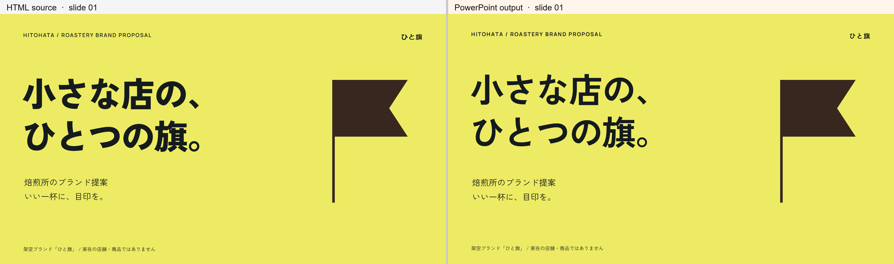
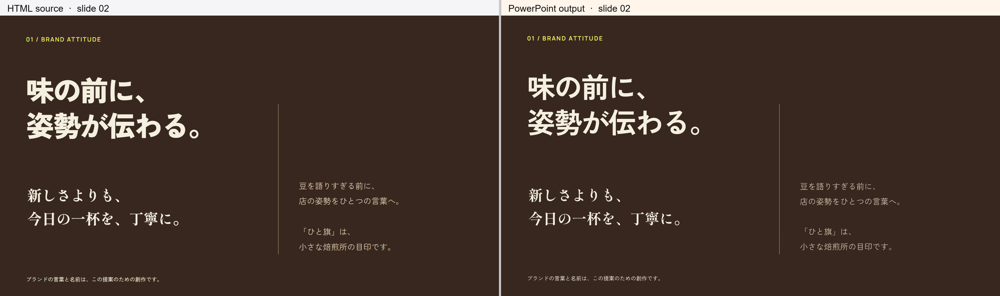
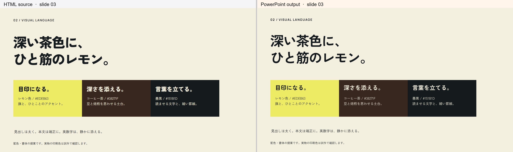
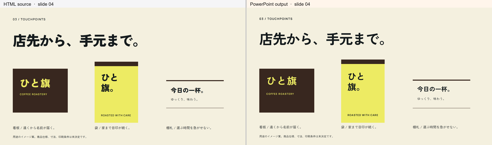
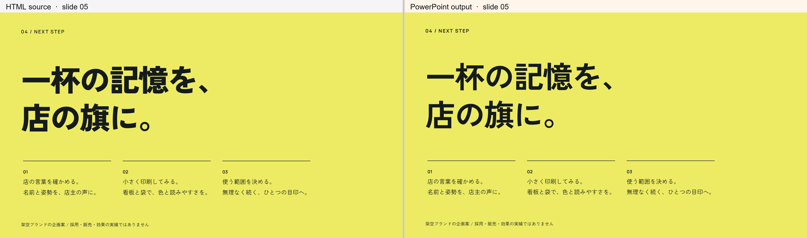

# HTML/PPTXの全頁比較

左：修復用HTML、右：現在のPowerPoint描画。字体埋込みは未実証で、このPPTXは埋込なし。HTMLのweight900とPowerPointのbold写像・端末字体により、右の見出しが細く見える差がある。字重の完全一致は示さない。旗は同形の5頂点専用native adapterを使う。

## 1頁

## 2頁

## 3頁

## 4頁

## 5頁

