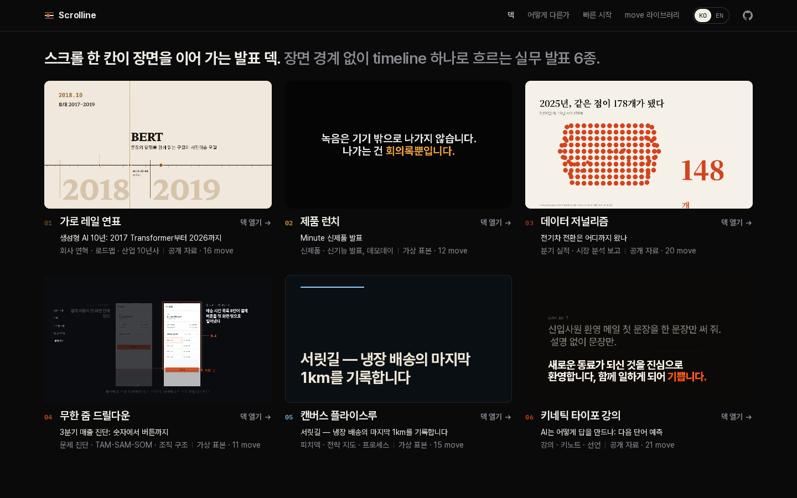
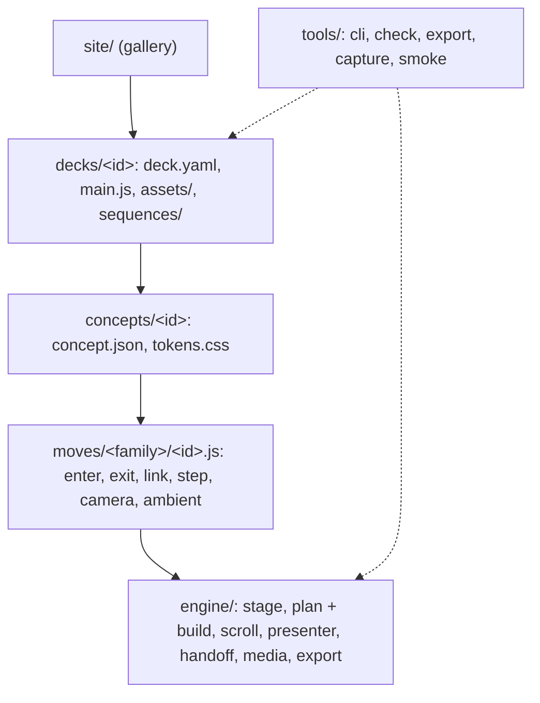

<p align="center">

</p>

<h1 align="center">Scrolline</h1>

<p align="center"><b>Scroll-driven presentation decks: one stage, one continuous timeline, and moves that turn one element into the next.</b></p>

<p align="center">
<a href="LICENSE"></a>

</p>

<p align="center">
<a href="README.ko.md">한국어</a> · <a href="docs/getting-started.md">Getting started</a> · <a href="SKILL.md">Claude Code skill</a> · <a href="docs/architecture.md">Architecture</a>
</p>

You write a `deck.yaml`. Scrolline lays every beat on one paused GSAP timeline, the mouse wheel scrubs it, presenter keys jump between stops, and the same timeline renders to MP4.

## Why v2

- **v1 reused 12 scene templates**, so every deck read as the same deck with new pictures. v2 has no scenes: a deck is one continuous master timeline on one stage.
- **Beats hand off instead of cutting.** A link move carries part of one beat (a bar, a dot, a date) into the place it holds in the next beat, so the audience follows one object rather than a slide change.
- **Each concept has its own motion grammar.** A concept pack fixes the camera axis, timing and allowed moves, and names signature moves the deck must use. The six example decks move differently because their grammars differ.


> Adding video? Issue your own Pexels or Pixabay API key first and keep it in `.env` (git-ignored, blocked by `npm run check`). See [docs/media.md](docs/media.md).

## Example decks

Six decks, one per concept. Decks marked *sample* use a fictional company and say so on screen. The others use real data with a source list in `deck.yaml`.

| Deck | Concept | Typical use | Signature moves |
|---|---|---|---|
| [`rail-ai-decade`](decks/rail-ai-decade/deck.yaml) · Generative AI, 2017 to 2026 | `rail` · horizontal time rail | company history, roadmap, an industry's decade | `rail-advance` `era-shift` `counter-handoff` |
| [`data-ev-shift`](decks/data-ev-shift/deck.yaml) · How far the EV shift has come | `data` · data journalism | quarterly results, market analysis | `dot-multiply` `mark-morph` `annotation-pin` |
| [`launch-orbit-note`](decks/launch-orbit-note/deck.yaml) · Minute product launch *(sample)* | `launch` · product launch | product or feature launch | `lit-from-dark` `sticky-scrub-link` `number-slam` |
| [`zoom-root-cause`](decks/zoom-root-cause/deck.yaml) · Q3 revenue diagnosis *(sample)* | `zoom` · infinite zoom drill-down | root cause, TAM-SAM-SOM, org structure | `zoom-dive` `zoom-surface` `depth-ladder` |
| [`canvas-pitch`](decks/canvas-pitch/deck.yaml) · Seed pitch on a map *(sample)* | `canvas` · camera flythrough | pitch deck, strategy map, process | `arc-flight` `establish-crane` `atlas-pullback` |
| [`kinetic-next-word`](decks/kinetic-next-word/deck.yaml) · How AI writes an answer | `kinetic` · kinetic type lecture | lecture, keynote, statement | `word-door` `slot-pick` `phrase-fold` |

The decks are in Korean. See [docs/concepts.md](docs/concepts.md) for what each concept allows.

## Quick start

Requires Node.js 22 or newer. ffmpeg is needed only to cut frame sequences, and the HyperFrames CLI (fetched by `npx`) only to export MP4.

```bash
git clone https://github.com/gongnyang/awesome-html-scrolline-deck.git
cd awesome-html-scrolline-deck
git checkout v2
npm install
npm run dev
```

Open `http://localhost:5173/decks/rail-ai-decade/` and scroll, or press <kbd>→</kbd>.

Start your own deck from a concept:

```bash
npm run deck -- new my-review --concept data   # decks/my-review/{deck.yaml,index.html,main.js,assets/}
# write beats in decks/my-review/deck.yaml
npm run deck -- plan my-review                  # stops and timings, computed in node
npm run export -- my-review                     # out/export/my-review.mp4
```

The full walkthrough is in [docs/getting-started.md](docs/getting-started.md), and every `deck.yaml` field is in [docs/writing-a-deck.md](docs/writing-a-deck.md).

## A beat in `deck.yaml`

```yaml
- id: b-trend
  type: chart
  kind: bar
  categories: ["Q1", "Q2", "Q3"]
  series:
    - { name: "Revenue ($M)", values: [3.1, 3.6, 4.2] }
  title: "Each quarter added about $0.5M"
  states:
    - name: steps
      notes:
        - { index: 1, text: "+0.5" }
        - { index: 2, text: "+0.6" }
  place: { slot: full }
  steps:
    - { name: steps, move: annotation-pin }   # a stop after the step
```

Beats hold content and moves hold motion. A beat renderer draws only the finished state. The concept supplies default moves, and each beat can name its own `enter`, `exit`, `link`, `steps`, `camera` or `ambient` move.

## Structure



- **engine** knows nothing about content. It renders beats, plans the timeline in node (no DOM), builds the master timeline, drives it from scroll and keys, and exports.
- **moves** are small units of motion with a fixed contract: pure `timing`, deterministic `build`, no `tl.from`, no clock or `Math.random`. Each move ships with a test.
- **concepts** pick a camera axis, timing, eases, tokens and an allow list of moves.
- **decks** are data plus assets. Deck-only scenes go in `sequences/`.

Imports only go downward, and `npm run check` blocks upward imports, cycles and imports across sibling folders. See [docs/architecture.md](docs/architecture.md).

## Presenter keys

| Key | Action |
|---|---|
| <kbd>→</kbd> <kbd>↓</kbd> <kbd>Space</kbd> <kbd>PageDown</kbd> | next stop |
| <kbd>←</kbd> <kbd>↑</kbd> <kbd>Shift</kbd>+<kbd>Space</kbd> <kbd>PageUp</kbd> | previous stop |
| <kbd>Home</kbd> <kbd>End</kbd> | first, last stop |
| <kbd>b</kbd> <kbd>.</kbd> | blackout |
| <kbd>f</kbd> | fullscreen |

The wheel and the keys move the same scroll position. A key press travels to the next stop in 0.9 to 2.6 s, depending on distance. With reduced motion, or with `?motion=reduce`, the jump is instant and moves fall back to fades of the same length, so every stop lands at the same time.

## Video

| Need | How | Beat |
|---|---|---|
| Video that scrubs with the scroll | image sequence drawn on a canvas, cut with `npm run frames` | `type: video`, `mode: scrub` |
| Live footage inside a beat | `<video muted playsinline>` that plays while the beat is active | `type: video`, `mode: play` or `loop` |
| Video inside letters or a shape | text mask applied by a move (`mask-word-in`), or a `clip-path` shape | `mask: { type: text, text: "10년" }` |

Scrubbed video uses frames rather than `video.currentTime` so that seeking is exact in both directions on every browser. See [docs/media.md](docs/media.md).

## MP4 export

```bash
npm run export -- rail-ai-decade                # out/export/rail-ai-decade.mp4
npm run export -- rail-ai-decade --dry-run      # print the timeline map and path only
npm run capture -- rail-ai-decade --stops       # one PNG per stop in out/capture/rail-ai-decade/
```

Export replaces scrolling with a presentation path. It travels from stop to stop, holds 1.6 s on each one (`exportHold` per beat), and renders the paused timeline through [HyperFrames](https://github.com/heygen-com/hyperframes) at 1920×1080. Because the timeline depends only on time, the MP4 shows the same frames as the browser. See [docs/export.md](docs/export.md).

## Tests and CI

```bash
npm test         # vitest + happy-dom: engine modules, every move, every deck
npm run check    # dependency rules, a test next to every module, state schemas, move static rules
npm run ci       # both; the merge condition
```

Move tests run a shared contract check: seek determinism, rewind to the initial state, no blur or 3D under reduced motion, and handoff landing within 1 px. GitHub Actions runs `npm ci`, `npm test` and `npm run check` on every push to `main` and `v2`, and on every pull request.

## Use it from Claude Code

`SKILL.md` makes this repository a Claude Code skill named `scrolline-deck`. It takes you from a brief to a concept, then `deck.yaml`, a smoke run and the MP4. Link the checkout into your skills folder:

```bash
ln -s "$PWD" ~/.claude/skills/scrolline-deck
```

## Repository layout

```text
engine/      stage, timeline plan/build, scroll, presenter, handoff, media, export, beat renderers
moves/       move library by family (reveal, type, morph, camera, rail, data, media, assemble, emphasis)
concepts/    concept packs: concept.json + tokens.css
decks/       example decks: deck.yaml + main.js + assets/
tools/       cli, checks, export, capture, smoke, frame extraction
site/        gallery
docs/        guides
plan/        design source of truth (Korean): PLAN, ARCHITECTURE, CONTRACTS
state/       board.json + runs.jsonl build-state log
```

## Contributing

See [CONTRIBUTING.md](CONTRIBUTING.md). In short, keep commits small, put a test next to every module, keep each commit to one hat (`Hat: feature` or `Hat: refactor`), and run `npm run ci` before a pull request.

## License and credits

Code: [MIT](LICENSE) © gongnyang.

- **Motion sources.** Every move lists the techniques it borrows from in `sources`, using slugs from [awesome-ai-motion](https://github.com/gongnyang/awesome-ai-motion).
- **References.** Scroll stories and keynotes such as The Pudding, Our World in Data, The New York Times, Codrops and Apple product pages were studied for ideas only. No code or assets from them are included. See [docs/attribution.md](docs/attribution.md).
- **Stock footage.** Pexels License, credited per deck in `decks/<id>/assets/CREDITS.md`. Other media was rendered for this repository.
- **Data.** Each non-sample deck lists its sources, with access dates, in `deck.yaml`.
- **Dependencies.** Built on [GSAP](https://gsap.com) (GreenSock standard no-charge license), [Lenis](https://github.com/darkroomengineering/lenis) (MIT) and [Vite](https://vite.dev) (MIT). [HyperFrames](https://github.com/heygen-com/hyperframes) (Apache-2.0) renders the exports.
