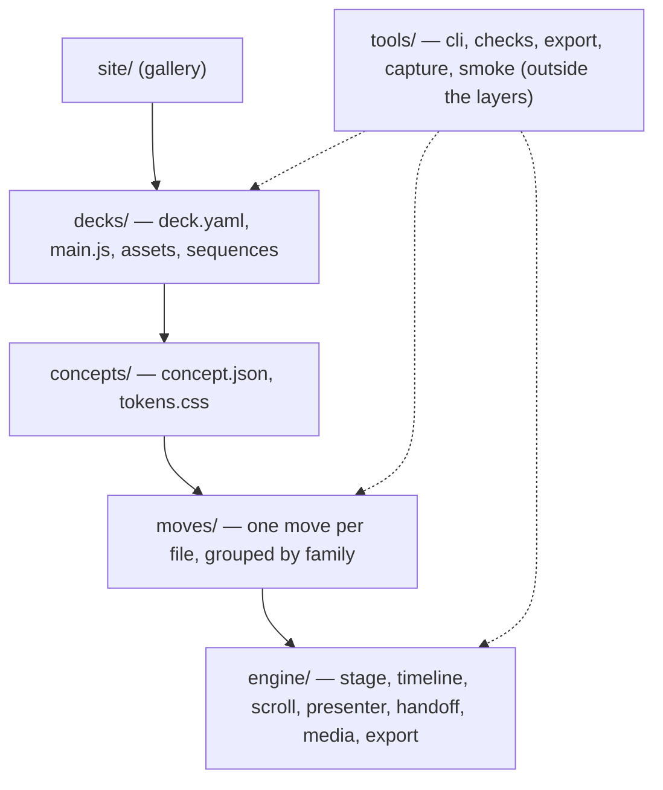

# Architecture

How Scrolline v2 is put together, the rules that keep it that way, and where project state lives.

The source of truth for design is `plan/` (written in Korean): `ARCHITECTURE.md` (reasons), `CONTRACTS.md` (interfaces). When code and `CONTRACTS.md` disagree, the code is wrong. This page is an English summary.

## Layers

A deck is built from three layers on top of an engine. Each layer imports only from the layers below it.



| Layer | Knows | Does not know |
|---|---|---|
| `engine/` | Stage, master timeline, scroll driver, presenter keys, handoff measurement, media, accessibility, export path, 10 beat renderers | Any content, any concept |
| `moves/` | How one thing appears, leaves, links to the next beat, changes in place, moves the camera, or idles | Which deck or concept uses it |
| `concepts/` | Camera axis, timing, eases, allowed beats and moves, signature moves, defaults, slots, tokens, colors and fonts | The content of a deck |
| `decks/` | Content: beats, sources, media, deck-only sequences | Engine internals |

## Dependency rules

`tools/check-deps.mjs` (part of `npm run check`) builds the import graph of every `.js` / `.mjs` file and fails on:

| Rule | Meaning |
|---|---|
| R1 downward only | Layer rank `engine` 0 < `moves` 1 < `concepts` 2 < `decks` 3 < `site` 4. A file imports only its own layer or lower |
| R2 public entry points | Across layers, only `engine/index.js`, `engine/engine.css`, `engine/testing.js` (tests only), `moves/index.js`, `concepts/<id>/index.js`, `concepts/<id>/tokens.css` |
| R3 no cycles | Zero cycles in the file-level import graph |
| R4 sibling isolation | `concepts/a` does not import `concepts/b`; same for decks and move families. `moves/_shared/` is the one shared folder |
| R5 external packages | `gsap` only in `engine/` (moves get `ctx.gsap`); `lenis` only in `engine/scroll.js`; `yaml` only in `tools/`; `happy-dom` only in `engine/testing.js`; `vitest` only in tests; `three` not allowed; `node:` built-ins only in tools and tests |

`tools/` sits outside the layers: it may import anything, and nothing imports it.

## Key decisions

| # | Decision | Why |
|---|---|---|
| D1 | Timing is pure and layout-free. `plan(deck)` computes stops and beat spans in node, without a DOM. A move's `timing(params, data)` is pure too | Same time shows the same content after resize, in portrait and with reduced motion. Export knows the video length in node. Stops are testable without a browser |
| D2 | A beat renders DOM; a move animates it | A beat renderer builds the finished state with `data-part` elements and never animates. The same beat can get different motion in different concepts |
| D3 | Scroll video = image sequence on canvas; in-scene video = `<video>`; deck to MP4 = HyperFrames render along a presentation path | Exact, symmetric seeking; deterministic render. See [media.md](media.md) and [export.md](export.md) |
| D4 | No scene boundaries | One stage, one master timeline, `stop:*` labels for presenting, and handoff: the outgoing element becomes the incoming one |
| D5 | 3D is camera language only | Only `.sl-camera` and `[data-depth]` layers carry 3D properties. No rotating objects or wireframes |

## Continuous timeline

- **One stage**, fixed to the window (1920 × 1080 in export):

```text
.sl-stage
├── .sl-viewport      perspective
│   └── .sl-camera    preserve-3d; only camera moves touch it
│       └── .sl-world beats placed with place.world (x, y in screens, z, s)
├── .sl-screen        beats placed with place.slot; unaffected by the camera
└── .sl-overlay       per-move overlay containers, on top
```

- **One master timeline**: `gsap.timeline({ paused: true })`. Each move builds a local timeline that the engine adds at its span start. There are no per-scene pins or ScrollTriggers.
- **Units**: 1 u of timeline = `viewport.h × unit` px of scroll (default `unit` 0.55). Track height = `h + duration × h × unit`.
- **Beats overlap by default**: the next beat starts at the previous beat's exit start + `overlap`, so the screen is never empty unless a deck asks for it (`at` > 0). A `link` replaces the exit and joins two beats in one motion.
- **Inside a beat**: `link in → enter → stop → hold → steps (each ends in a stop) → exit or link out`, with `camera` in parallel from the start and `ambient` for the whole life of the beat.
- **Stops**: labels `stop:<beatId>` and `stop:<beatId>/<sub>`. Presenter keys only travel between these labels; wheel and keys share one Lenis scroll position.
- **Handoff**: before building, the engine measures every part's rect once with transforms removed. A `link` move carries `ctx.handoff.from` (a part of beat A) to `ctx.handoff.to.rect` (a part of beat B); at the end B's part is visible and A's is hidden, with at most 0.15 u of crossfade. B's enter skips that part.
- **Determinism**: moves declare start state with `ctx.initial`, never use `tl.from()`, use `fromTo(..., { immediateRender: false })`, draw randomness from a seeded `ctx.rng()`, and never read clocks. The same timeline time always gives the same pixels, which is what scroll, presenter keys and MP4 export rely on.
- **Reduced motion**: smoothing off, keys jump instantly, `reduce: 'fade'` moves are replaced by a built-in fade of the same length (stops unchanged), `reduce: 'self'` moves drop blur, depth and tilt themselves. Force it with `?motion=reduce`.
- **Resize**: debounced 200 ms; same width with < 15 % height change is ignored. Otherwise the engine remembers t, clears the stage, rebuilds from the same map and seeks back to t.

## 3D rule

- Allowed: perspective tilt up to 12°, depth parallax through `[data-depth]` layers (0 far, 1 near), camera fly-through between world coordinates, infinite zoom by chained scale.
- Not allowed: explanatory 3D objects, and `rotationX/Y`, `z`, `translateZ`, `perspective` or `transformPerspective` tweens outside the `camera` family.
- Enforced by `tools/check-moves.mjs` (static scan, also rejects `.from(`, `var(` inside tween values and `Math.random` / `Date.now` / `performance.now`) and by the move contract test that runs each move with `reduce: true`.

## Fowler's five principles in this repo

| Principle | Here |
|---|---|
| Evolutionary design, small steps | Every step ends with a deck that runs. The `_smoke` deck came first; one deck (rail) was taken to the end before the others. One job = one module |
| Self-testing code | `npm test` (vitest + happy-dom). Every engine module and every move has a `.test.js` next to it; `check-tests` fails otherwise. Tests cover seek determinism, handoff coordinates and exact stop times. See [moves.md](moves.md) for the move harness |
| Continuous integration | `npm run ci` = `npm test && npm run check`. `.github/workflows/ci.yml` runs `npm ci`, `npm test`, `npm run check` on Node 22 for pushes to `main` and `v2` and for pull requests. Work is merged only when green |
| Two hats | A commit is either `Hat: feature` (adds behavior; must add or change at least one test) or `Hat: refactor` (no behavior change; must not edit existing tests, may add new `<name>.<topic>.test.js` files). The trailer is checked by `node tools/check.mjs --hat <base>..<head>` |
| Module boundaries, cohesion | One-way layers, public entry points, sibling isolation, package placement and zero cycles, all enforced by `check-deps` |

## Gates

| Gate | Command | What it stops |
|---|---|---|
| Tests | `npm test` | Broken timing, non-deterministic seeks, wrong stop times, handoff errors, move contract violations |
| Static checks | `npm run check` | `deps` (R1–R5), `tests` (missing test files; `@stub` in the first 30 lines exempts a scaffold), `state` (board and runs schemas), `moves` (3D, `.from(`, `var(`, clocks) |
| Deck validation | `validateDeck`, run by `boot` (errors are drawn on the page) and by each deck's `deck.test.js` | Unknown fields, placeholder text (`TODO`, `TBD`, `lorem`, `???`, `{{`, empty strings, …), numbers, charts, quotes, real photos and valued comparisons without a `source` (unless `sample: true`), moves outside the concept's allow list without `override`, the same move twice in the same role without `repeat: intended` |
| Visual | `node tools/smoke.mjs`, `npm run capture` | Boot errors, empty stops, overlapping or clipped text, tiny text. See [export.md](export.md) |
| Judgement | People reading the capture sheet and the MP4 | One focal point per frame, a three-level hierarchy, a conclusion readable in five seconds, no decorative 3D, no meta captions |

## State management

Project state follows the LangSmith model so that every job and every judgement is traceable.

| LangSmith | Here |
|---|---|
| project | One deck |
| trace | One wave (a `run_type: wave` root run) |
| run | One job (research, design, build, judge, render, repair) |
| feedback | One judgement score attached to a run |
| dataset | The reference ledger under `research/ledger` |

State lives in `state/` only. Prose documents never record status.

`state/board.json` is the current snapshot, written by the orchestrator only:

```json
{
  "version": 1,
  "updated": "2026-10-08T17:00:00",
  "waves":    { "W4": { "root_run_id": "…", "status": "running" } },
  "engine":   { "E2": { "files": ["engine/timeline.js"], "status": "pass", "runs": ["…"] } },
  "concepts": { "rail": { "stage": "done", "status": "pass", "runs": [] } },
  "moves":    { "rail-advance": { "family": "rail", "stage": "merged", "status": "pass", "runs": [] } },
  "decks":    { "rail-ai-decade": { "concept": "rail", "stage": "judge", "status": "review", "score": { "wow": 0.7 }, "runs": [] } }
}
```

- Stages: engine `spec | impl | tested | merged`; concept `direction | storyboard | tokens | done`; move `inventory | spec | impl | tested | merged`; deck `brief | storyboard | assemble | judge | repair | done`.
- Status: `todo | running | review | pass | fail | blocked`.

`state/runs.jsonl` is an append-only event log, one JSON record per line:

- **Run lines**: one line with `status: running` when a job starts, and one more with the same `run_id` when it ends (`success | error | cancelled`). The last line for a `run_id` is its current state. Required fields: `run_id`, `parent_run_id` (null for a root), `root_run_id`, `run_type`, `name`, `status`, `started_at`. Optional: `model`, `hat`, `target`, `inputs` / `outputs` with file hashes, `commit`, `tokens`, `error`, `ended_at`.
- **Feedback lines** (`kind: "feedback"`): `feedback_id`, `run_id` (the judged run), `key` (`wow | tech | content | diversity | a11y`), `score` 0–1, `by_run_id`, `time`, optional `value` and `comment`.

Schemas are in `state/schema/board.schema.json` and `state/schema/runs.schema.json`; `npm run check` validates both files (a missing file passes). The board's `runs` arrays link back to `runs.jsonl` by `run_id`.

## See also

- [getting-started.md](getting-started.md) — install and first deck
- [writing-a-deck.md](writing-a-deck.md) — `deck.yaml` reference
- [concepts.md](concepts.md) — concept packs
- [moves.md](moves.md) — move contract and harness
- [media.md](media.md) — frame sequences, clips, masks
- [export.md](export.md) — MP4, capture, smoke
