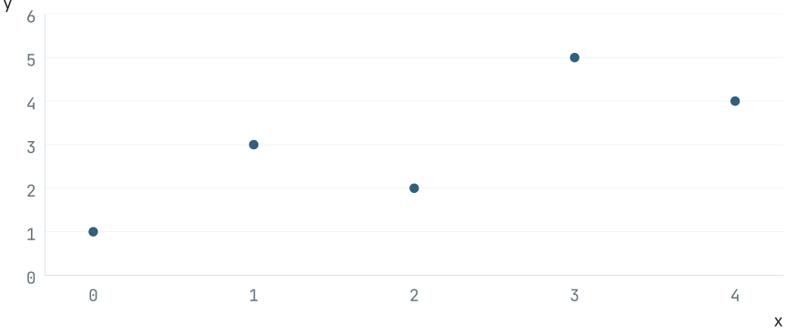
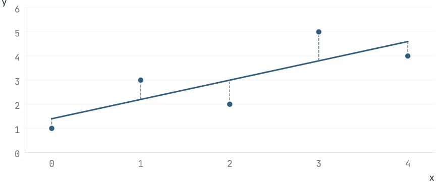

## 五つの点から、<br>一本の線を。 {.opening}

::: {.columns}
::: {.column width="54%"}
ばらつく点を、<br>一本の直線でどう表す？

::: {.context}
5分の小教材 ／ 単位のない合成データ<br>
現実の観測値や研究成果ではありません。
:::
:::
::: {.column width="36%"}
| 点 | x | y |
|:--|--:|--:|
| 1 | 0 | 1 |
| 2 | 1 | 3 |
| 3 | 2 | 2 |
| 4 | 3 | 5 |
| 5 | 4 | 4 |

::: {.context}
入力：`input/data.csv`
:::
:::
:::

::: {.notes}
問いを立ててから、5点の表を見せる。xとyは単位を持たない学習用の数。実測や因果関係は示していない。
:::

## 表を、点にする。 {.visual}

{fig-alt="合成5点 (0,1), (1,3), (2,2), (3,5), (4,4) の散布図"}

::: {.notes}
表と図は同じ入力を使う。点の上下にばらつきがあるので、すべての点を通る一本の直線にはならない。
:::

## 直線を、二つの数で表す。 {.math}

$$
y=ax+b
$$

::: {.definition}
**a**：傾き　　**b**：切片
:::

点から線への縦のずれを二乗し、その合計が小さくなる線を選ぶ。

::: {.context}
この選び方が「最小二乗」。傾きの単位や因果は、この合成例から決めない。
:::

::: {.notes}
NumPy公式linalg.lstsq文書の最小二乗の定義を踏まえる。ここでは二変数の係数aとbで直線を表す。数式は原典のmathクラスとQuarto KaTeXで描画。
:::

## コードで、線を求める。 {.code}

```python
import numpy as np
d = np.genfromtxt("input/data.csv", names=True, delimiter=",")
x, y = d["x"], d["y"]
X = np.column_stack([x, np.ones(len(x))])
a, b = np.linalg.lstsq(X, y, rcond=None)[0]
print(f"a={a:.1f}, b={b:.1f}")
```

::: {.actual-output}
実行結果　`a=0.8, b=1.4`
:::

::: {.context}
同じ処理を `source/compute_fit.py` で実行済み。<br>
[NumPy公式：linalg.lstsq](https://numpy.org/doc/stable/reference/generated/numpy.linalg.lstsq.html) ／ 詳細値：`output/results.json`
:::

::: {.notes}
コード表示は原典templateの普通のPython fenced block。実際の計算は同梱compute_fit.pyをPythonで実行した。Quartoがこの表示ブロックを実行したとは称さない。aとbを一桁へ丸めた表示と詳細結果JSONを分ける。
:::

## 線が言えること、言えないこと。 {.visual}

{fig-alt="合成5点に最小二乗直線y=0.8x+1.4を重ね、縦の残差を点線で示した図"}

::: {.context .limit}
この5点への当てはめ。外の範囲・現実の予測精度・原因は分からない。
:::

::: {.notes}
縦のずれを二乗した合計は実計算で3.6。これはこの設定の残差の量であり、科学的成果や未来の精度の証明ではない。
:::

## 点が一つ変わると、<br>線はどう動く？ {.question}

::: {.next-step}
一点を変える。<br>
同じコードを動かす。<br>
二本の線を、比べてみる。
:::

::: {.context}
入力の5点から、線とその限界を一緒に読む。
:::

::: {.notes}
次の実験を提案する問いで終える。変更後の計算を実行済みとは述べない。学習者がinput/data.csvを変え、同じcompute_fit.pyを実行できる。
:::
