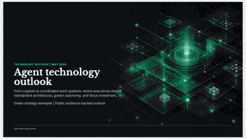
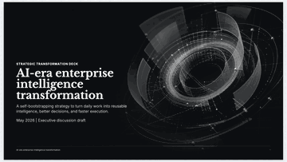
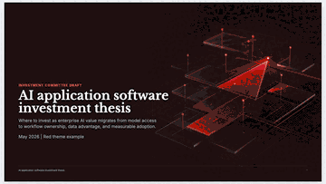

# MBB Page Maker

MBB Page Maker 给 coding agent 提供一套开箱即用的系统，用来生成咨询公司风格 HTML PPT：战略汇报、董事会材料、投资 memo、管理层决策页等。

安装一次后，可以在 Codex、Claude Code、Cursor、OpenClaw、Hermes 或任何能读取本地 skill package 的 agent 里使用。Deck 保持静态、可检查，并可导出为自包含 HTML、PDF 和 PNG。

> 设计约束：
>
> - 一条命令安装。
> - 不需要 build。
> - 纯静态 HTML/CSS/JS。
> - 默认导出自包含 HTML package、PDF 和 PNG。

## 示例 Gallery

<table width="100%" border="0" cellspacing="0" cellpadding="0" style="width:100%;border:0;border-collapse:collapse;">
  <tr>
    <td align="center" width="50%" style="border:0;">
      <a href="https://nomici.ai/mbb-page-maker/examples/ai-erp-saas-lop/index.html" target="_blank" rel="noopener noreferrer"></a><br>
      <a href="https://nomici.ai/mbb-page-maker/examples/ai-erp-saas-lop/index.html" target="_blank" rel="noopener noreferrer">ERP SaaS LOP</a>
    </td>
    <td align="center" width="50%" style="border:0;">
      <a href="https://nomici.ai/mbb-page-maker/examples/agent-technology-outlook/index.html" target="_blank" rel="noopener noreferrer"></a><br>
      <a href="https://nomici.ai/mbb-page-maker/examples/agent-technology-outlook/index.html" target="_blank" rel="noopener noreferrer">Agent Technology Outlook</a>
    </td>
  </tr>
  <tr>
    <td align="center" width="50%" style="border:0;">
      <a href="https://nomici.ai/mbb-page-maker/examples/enterprise-intelligence-transformation/index.html" target="_blank" rel="noopener noreferrer"></a><br>
      <a href="https://nomici.ai/mbb-page-maker/examples/enterprise-intelligence-transformation/index.html" target="_blank" rel="noopener noreferrer">Enterprise Intelligence Transformation</a>
    </td>
    <td align="center" width="50%" style="border:0;">
      <a href="https://nomici.ai/mbb-page-maker/examples/ai-application-investment-thesis/index.html" target="_blank" rel="noopener noreferrer"></a><br>
      <a href="https://nomici.ai/mbb-page-maker/examples/ai-application-investment-thesis/index.html" target="_blank" rel="noopener noreferrer">AI Application Investment Thesis</a>
    </td>
  </tr>
</table>

Template preview: [Full-Deck Template Index](https://nomici.ai/mbb-page-maker/templates/full-decks/index.html)

> 直接告诉你的 agent：
>
> ```bash
> npx skills add https://github.com/NomiciAI/mbb-page-maker
> ```
>
> 然后在 Codex、Claude Code、Cursor、OpenClaw、Hermes 或其他兼容 coding agent 里说：`Use mbb-page-maker to create...`

## 安装

从 GitHub 安装 skill package：

```bash
npx skills add https://github.com/NomiciAI/mbb-page-maker
```

为了让更多 agent 自动发现，推荐安装到所有检测到的客户端：

```bash
npx skills add https://github.com/NomiciAI/mbb-page-maker --agent '*'
```

如果你同时使用 Codex、Claude Code、Cursor、OpenClaw、Hermes 或类似 coding agent，这是推荐安装方式。

如果某个客户端显示 `Unknown skill`，但 `.agents/skills/mbb-page-maker/` 已存在，说明包已经安装，只是没有链接到该客户端自己的 skill 目录。运行：

```bash
.agents/skills/mbb-page-maker/scripts/link-agent-adapters.sh .
```

具体项目级/全局路径和客户端排查见 `references/agent-compatibility.md`。

## 怎么让 Agent 使用

安装后，在 prompt 里明确点名 `mbb-page-maker`，并告诉 agent：受众、决策场景、输入材料、期望输出。

```text
Use mbb-page-maker，把下面的材料做成 10 页董事会汇报。
受众：CEO 和直属管理团队。
目标：对齐未来两个季度的 AI 产品投资计划。
使用 blue executive theme。完成 HTML deck 后，导出 package、PDF 和 PNG 页面图。
```

```text
Use mbb-page-maker，把这份投资 memo 改成 IC-ready deck。
故事线要 recommendation-led，包含市场结构、投资逻辑、风险和 decision asks。
使用 red investment style，保持精炼，面向高管和投委会。
```

```text
Use mbb-page-maker，优化这个已有 deck。
收紧故事线，用更强的咨询式 layout 替换弱页面，检查 overflow，
完成后导出 self-contained HTML package。
```

好的 prompt 通常包括：

- 受众和决策场景。
- 输入材料或数据。
- 目标页数或汇报时长。
- 主题偏好，如果有。
- 交付格式：只要 HTML，还是需要 HTML package、PDF 和 PNG。

## 手动 Quick Start

```bash
# 下载仓库
git clone https://github.com/NomiciAI/mbb-page-maker.git
cd mbb-page-maker

# 用浏览器打开公开 demo decks
open examples/ai-erp-saas-lop/index.html
open examples/agent-technology-outlook/index.html
open examples/enterprise-intelligence-transformation/index.html
open examples/ai-application-investment-thesis/index.html

# 打开 full-deck template 汇总页
open templates/full-decks/index.html

# 从 starter template 新建一个 deck
./scripts/new-deck.sh my-talk
open my-talk/index.html

# 导出自包含 HTML package、PDF 和 PNG 页面图
./scripts/render.sh my-talk/index.html
open my-talk/dist/package/index.html
# 生成的 PDF 会保留在 my-talk/dist/index.pdf，并复制到 my-talk/dist/package/index.pdf。

# 导出前可选预检：发现被裁切或越界的页面内容时失败
./scripts/check-deck-fit.sh my-talk/index.html
```

## Design System

MBB Page Maker 的核心原则很简单：源 deck 应该可读、可编辑、可迁移。生成结果就是 HTML、CSS、JavaScript 和本地静态资源。最终 package 不依赖框架 runtime、不需要 build，也不依赖 CDN。

设计系统把结构和风格拆开：

- `base.css`: slide 画布、字体层级、runtime controls 和 print 规则。
- `layouts.css`: 页面级 layout shell。
- `components.css`: 表格、卡片、指标、roadmap、矩阵和 profile blocks。
- `illustrations.css`: 中性视觉 primitives 和静态资源插槽。
- `themes/*.css`: blue、green、red、pitch、mono、classic 等主题 token。
- `assets/media/`: 可选静态图片、cover、截图和 showcase 素材。

推荐的生成方式是组合式的。agent 从一个简单 deck shell 开始，先判断 message structure，再选择 layout 和 component，套用主题，最后做 render check。模板不是固定套版：`templates/full-decks/` 用来参考 storyline pacing，`templates/showcase/` 用来看单页 pattern，`examples/` 展示公开完成版 demo。

导出方式刻意保持简单。`scripts/render.sh` 会生成自包含 HTML package、PDF 和 PNG 页面图。最终 package 会内联本地 CSS、JavaScript、字体和媒体资源，让 `package/index.html` 可以直接用浏览器打开。启用 PDF 导出时，生成的 PDF 会继续保留在 `dist/`，并同时复制到 `dist/package/index.pdf`，让分享文件夹里同时有浏览器版和可打印版。浏览器截图自动化应当用 1600x900 viewport 打开 `index.html?slide=N&export=1`，或者直接使用生成好的 `dist/png/slide-XX.png`。

## 项目结构

核心结构分成五层：

- `SKILL.md`: skill 入口和调度规则。
- `references/`: agent 兼容性、pattern index、主题、布局、视觉资产、咨询式思考流程、完整 deck 结构和写作流程。
- `assets/`: 静态 HTML PPT runtime、CSS design system、主题 token。
- `templates/`: `starter-deck.html`、design-system gallery、full-deck archetype、showcase 思维/组合案例、light/dark/mixed/neutral skeleton 和布局模板。
- `scripts/`: 新建 deck、字体刷新、agent adapter 链接、可见性检查和导出 PNG/PDF/HTML。

## 贡献

欢迎通过 pull request 贡献。`main` 分支受保护：Saitop 可以直接 push，其他 collaborator 和外部 contributor 都应通过 PR 提交变更。

PR 规则、测试说明和仓库维护要求见 `CONTRIBUTING.md`。

## 致谢

受 [lewislulu/html-ppt-skill](https://github.com/lewislulu/html-ppt-skill) 启发。本项目为从零编写，拥有独立的结构、模板、运行时和设计系统。

## License & Author

Apache-2.0. Copyright 2026 Saitop <<saitop@nomici.ai>>.
