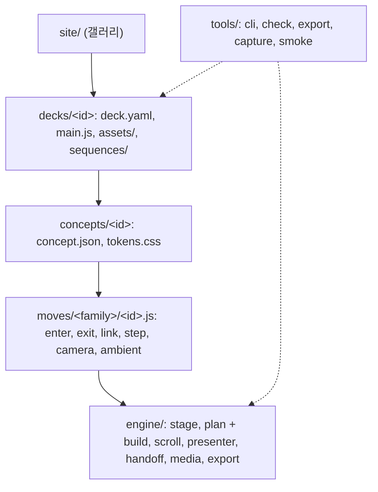

<p align="center">

</p>

<h1 align="center">Scrolline</h1>

<p align="center"><b>스크롤로 진행하는 발표 덱. 무대 하나, 연속 timeline 하나, 앞 요소가 다음 요소로 이어지는 move.</b></p>

<p align="center">
<a href="LICENSE"></a>

</p>

<p align="center">
<a href="README.md">English</a> · <a href="docs/getting-started.md">Getting started</a> · <a href="SKILL.md">Claude Code 스킬</a> · <a href="docs/architecture.md">Architecture</a>
</p>

- 입력: `deck.yaml` 1개
- 처리: 모든 beat를 paused GSAP master timeline 1개에 배치. 휠 = timeline 스크럽, 발표 키 = 정지점 이동
- 출력: 브라우저 발표 덱 + 같은 timeline으로 렌더한 MP4

## 1. v2를 새로 만든 이유

- **장면 템플릿 반복 폐기**: v1은 장면 템플릿 12종을 재사용해 덱마다 그림만 다르고 같은 덱으로 읽힘. v2는 장면 단위가 없고 덱 1개 = 무대 1개 위 연속 timeline 1개
- **컷 대신 handoff**: link move가 앞 beat의 요소(막대·점·날짜)를 다음 beat에서 그 요소가 놓일 자리로 운반. 청중은 화면 전환이 아니라 물체 하나를 따라감
- **컨셉별 움직임 문법**: 컨셉 팩이 카메라 축·timing·허용 move·signature move를 고정. 예제 덱 6종의 움직임이 서로 다른 근거


> 영상을 넣기 전에: Pexels·Pixabay API 키를 직접 발급해 `.env`에 두는 것을 권장합니다(`.env`는 git 제외, `npm run check`가 키 커밋을 막음). 자세히: [docs/media.md](docs/media.md)

## 2. 예제 덱

- 컨셉당 1편, 총 6편. 화면 언어는 한국어
- *표본* = 가상 회사 덱(화면에 「표본」 표기). 나머지는 실데이터, 출처 목록은 `deck.yaml`의 `sources`

| 덱 | 컨셉 | 실무 쓰임 | signature move |
|---|---|---|---|
| [`rail-ai-decade`](decks/rail-ai-decade/deck.yaml) · 생성형 AI 10년: 2017 Transformer부터 2026까지 | `rail` · 가로 레일 연표 | 회사 연혁, 로드맵, 산업 10년사 | `rail-advance` `era-shift` `counter-handoff` |
| [`data-ev-shift`](decks/data-ev-shift/deck.yaml) · 전기차 전환은 어디까지 왔나 | `data` · 데이터 저널리즘 | 분기 실적, 시장 분석 보고 | `dot-multiply` `mark-morph` `annotation-pin` |
| [`launch-orbit-note`](decks/launch-orbit-note/deck.yaml) · Minute 신제품 발표 *(표본)* | `launch` · 제품 런치 | 신제품·신기능 발표 | `lit-from-dark` `sticky-scrub-link` `number-slam` |
| [`zoom-root-cause`](decks/zoom-root-cause/deck.yaml) · 3분기 매출 진단: 숫자에서 버튼까지 *(표본)* | `zoom` · 무한 줌 드릴다운 | 문제 진단, TAM-SAM-SOM, 조직 구조 | `zoom-dive` `zoom-surface` `depth-ladder` |
| [`canvas-pitch`](decks/canvas-pitch/deck.yaml) · 서릿길 시드 투자 피치 *(표본)* | `canvas` · 캔버스 플라이스루 | 피치덱, 전략 지도, 프로세스 | `arc-flight` `establish-crane` `atlas-pullback` |
| [`kinetic-next-word`](decks/kinetic-next-word/deck.yaml) · AI는 어떻게 답을 만드나: 다음 단어 예측 | `kinetic` · 키네틱 타이포 강의 | 강의, 키노트, 선언 | `word-door` `slot-pick` `phrase-fold` |

- 컨셉별 허용 범위: [docs/concepts.md](docs/concepts.md)

## 3. 빠른 시작

- 필수: Node.js 22 이상
- 선택: ffmpeg(프레임 시퀀스 추출), HyperFrames CLI(MP4 내보내기, `npx`가 받아 실행)

```bash
git clone https://github.com/gongnyang/awesome-html-scrolline-deck.git
cd awesome-html-scrolline-deck
git checkout v2
npm install
npm run dev
```

- 확인: `http://localhost:5173/decks/rail-ai-decade/` 접속 후 스크롤 또는 <kbd>→</kbd>

새 덱 작성 순서:

```bash
npm run deck -- new my-review --concept data   # decks/my-review/{deck.yaml,index.html,main.js,assets/}
# decks/my-review/deck.yaml 에 beat 작성
npm run deck -- plan my-review                  # 정지점·시간 배치를 node에서 계산
npm run export -- my-review                     # out/export/my-review.mp4
```

- 전체 절차: [docs/getting-started.md](docs/getting-started.md)
- `deck.yaml` 필드 전체: [docs/writing-a-deck.md](docs/writing-a-deck.md)

## 4. `deck.yaml`의 beat 예

```yaml
- id: b-trend
  type: chart
  kind: bar
  categories: ["Q1", "Q2", "Q3"]
  series:
    - { name: "매출(억 원)", values: [31, 36, 42] }
  title: "분기마다 약 5억 원씩 늘었다"
  states:
    - name: steps
      notes:
        - { index: 1, text: "+5" }
        - { index: 2, text: "+6" }
  place: { slot: full }
  steps:
    - { name: steps, move: annotation-pin }   # step 끝에 정지점
```

- beat = 내용, move = 움직임. beat 렌더러는 완성 상태 DOM만 그림
- 기본 move는 컨셉이 공급. beat마다 `enter`·`exit`·`link`·`steps`·`camera`·`ambient`를 직접 지정 가능

## 5. 구조



| 층 | 역할 |
|---|---|
| engine | 내용과 무관. beat 렌더, timeline 계획(node에서 DOM 없이), master timeline 조립, 스크롤·키 구동, 내보내기 |
| moves | 계약이 고정된 움직임 단위. `timing` 순수 함수, `build` 결정론, `tl.from`·시계·`Math.random` 금지, move마다 테스트 1개 |
| concepts | 카메라 축·timing·ease·tokens·허용 move 목록 |
| decks | 데이터 + 에셋. 덱 전용 장면은 `sequences/` |

- 의존 방향: 하향만. 역방향 import·순환·형제 폴더 간 import는 `npm run check`가 차단
- 상세: [docs/architecture.md](docs/architecture.md)

## 6. 발표 키

| 키 | 동작 |
|---|---|
| <kbd>→</kbd> <kbd>↓</kbd> <kbd>Space</kbd> <kbd>PageDown</kbd> | 다음 정지점 |
| <kbd>←</kbd> <kbd>↑</kbd> <kbd>Shift</kbd>+<kbd>Space</kbd> <kbd>PageUp</kbd> | 이전 정지점 |
| <kbd>Home</kbd> <kbd>End</kbd> | 처음·마지막 정지점 |
| <kbd>b</kbd> <kbd>.</kbd> | 블랙아웃 |
| <kbd>f</kbd> | 전체 화면 |

- 휠과 키는 같은 스크롤 좌표를 공유
- 키 이동 시간: 거리에 따라 0.9~2.6초
- reduced motion 또는 `?motion=reduce`: 즉시 이동, move는 같은 길이의 fade로 대체 → 정지점 시각 불변

## 7. 영상 연결

| 용도 | 방식 | beat |
|---|---|---|
| 스크롤에 맞춰 스크럽되는 영상 | canvas에 그리는 이미지 시퀀스, `npm run frames`로 추출 | `type: video`, `mode: scrub` |
| beat 안에서 재생되는 영상 | beat 활성 구간에만 재생하는 `<video muted playsinline>` | `type: video`, `mode: play` 또는 `loop` |
| 글자·도형 안의 영상 | move가 거는 글자 마스크(`mask-word-in`) 또는 `clip-path` 도형 | `mask: { type: text, text: "10년" }` |

- 스크럽에 `video.currentTime`을 쓰지 않는 이유: 프레임 파일 방식이 모든 브라우저에서 앞뒤 seek 모두 정확
- 상세: [docs/media.md](docs/media.md)

## 8. MP4 내보내기

```bash
npm run export -- rail-ai-decade                # out/export/rail-ai-decade.mp4
npm run export -- rail-ai-decade --dry-run      # timeline map·발표 경로만 출력
npm run capture -- rail-ai-decade --stops       # 정지점마다 PNG 1장, out/capture/rail-ai-decade/
```

- 스크롤을 「발표 경로」로 대체: 정지점 사이 이동 → 정지점마다 1.6초 정지(beat별 `exportHold`) → [HyperFrames](https://github.com/heygen-com/hyperframes)로 1920×1080 렌더
- timeline이 시간에만 의존하므로 MP4 프레임 = 브라우저 프레임
- 상세: [docs/export.md](docs/export.md)

## 9. 테스트·CI

```bash
npm test         # vitest + happy-dom: engine 모듈, move 전부, 덱 전부
npm run check    # 의존 규칙, 모듈별 테스트 존재, state 스키마, move 정적 규칙
npm run ci       # 위 둘. 병합 조건
```

- move 공통 계약 검사: seek 결정론, 되감기 후 초기 상태 복귀, reduced motion에서 blur·3D 없음, handoff 착지 오차 1px 이내
- GitHub Actions: `main`·`v2` push와 모든 pull request에서 `npm ci` → `npm test` → `npm run check`

## 10. Claude Code 스킬

- `SKILL.md` = 스킬 `scrolline-deck` 진입점. 브리프 → 컨셉 선택 → `deck.yaml` 작성 → smoke → MP4 순서로 진행
- 설치:

```bash
ln -s "$PWD" ~/.claude/skills/scrolline-deck
```

## 11. 폴더 구성

```text
engine/      stage, timeline plan/build, scroll, presenter, handoff, media, export, beat 렌더러
moves/       family별 move 라이브러리(reveal, type, morph, camera, rail, data, media, assemble, emphasis)
concepts/    컨셉 팩: concept.json + tokens.css
decks/       예제 덱: deck.yaml + main.js + assets/
tools/       cli, 검사, export, capture, smoke, 프레임 추출
site/        갤러리
docs/        가이드(영문)
plan/        설계 정본: PLAN, ARCHITECTURE, CONTRACTS
state/       board.json + runs.jsonl 작업 상태 기록
```

## 12. 기여

- 절차: [CONTRIBUTING.md](CONTRIBUTING.md)
- 요지: 작은 커밋, 모듈마다 옆에 테스트, 커밋 1개 = 모자 1개(`Hat: feature` 또는 `Hat: refactor`), pull request 전 `npm run ci`

## 13. 라이선스·출처

- 코드: [MIT](LICENSE) © gongnyang
- move 원천: move마다 `sources`에 [awesome-ai-motion](https://github.com/gongnyang/awesome-ai-motion) 기법 slug 기재
- 레퍼런스: The Pudding, Our World in Data, The New York Times, Codrops, Apple 제품 페이지 등 스크롤 스토리·키노트를 아이디어로만 참고. 원문 코드·에셋 미포함. 목록: [docs/attribution.md](docs/attribution.md)
- 스톡 영상: Pexels License, 덱별 `decks/<id>/assets/CREDITS.md`에 기재. 그 밖의 미디어는 이 레포용 자체 렌더
- 데이터: 표본이 아닌 덱은 `deck.yaml`에 출처·확인일 기재
- 의존성: [GSAP](https://gsap.com)(GreenSock standard no-charge license), [Lenis](https://github.com/darkroomengineering/lenis)(MIT), [Vite](https://vite.dev)(MIT). 내보내기 렌더는 [HyperFrames](https://github.com/heygen-com/hyperframes)(Apache-2.0)
