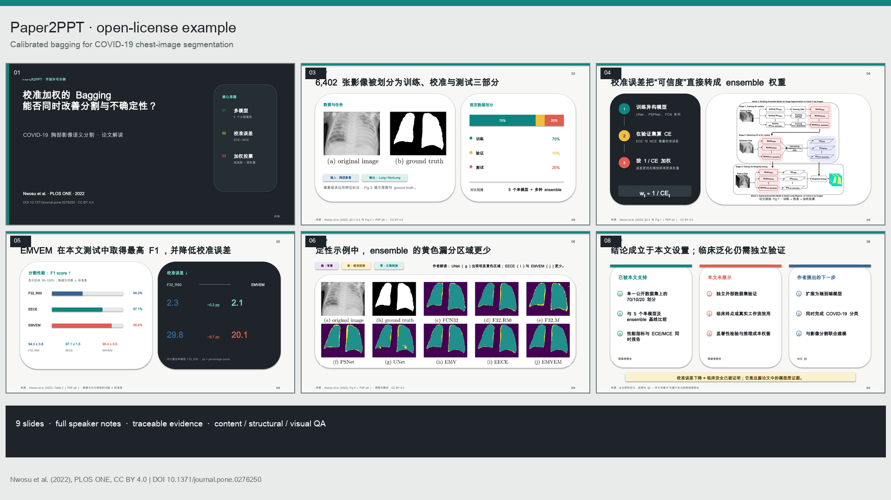
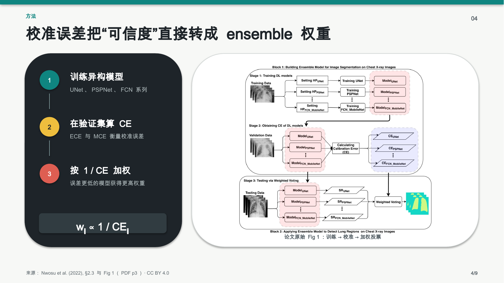
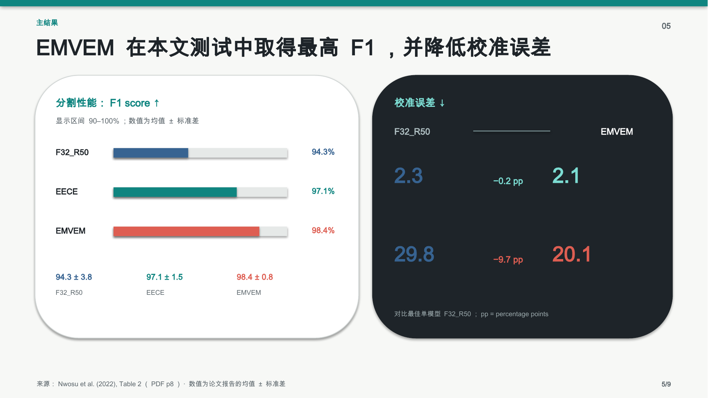
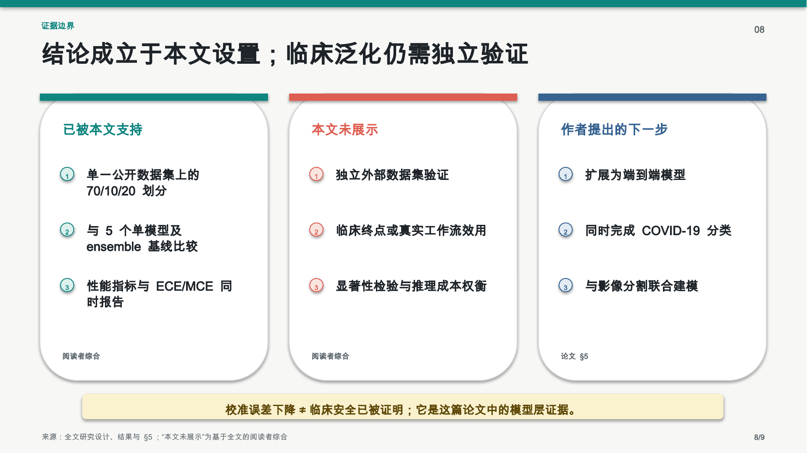

# Paper2PPT

简体中文 | <a href="README.en.md">English</a>

<p>
  
  
  
  
</p>

**把学术论文转成可编辑、可溯源、带讲稿并经过质量检查的中文 PPTX。**

Paper2PPT 是一个兼容 Codex 与 Claude Code 的 Agent Skill。它读取论文的论证链和证据，而不是机械照搬章节目录；默认生成适合 15-20 分钟汇报的 12-16 页简体中文幻灯片。

## 快速开始

```bash
git clone https://github.com/wp-a/paper2ppt.git
mkdir -p ~/.agents/skills
cp -R paper2ppt/plugins/paper2ppt/skills/paper2ppt ~/.agents/skills/
```

在新的 Codex 任务中输入：`使用 $paper2ppt 把这篇论文做成 15 分钟中文组会 PPT。`



<a href="examples/output/paper2ppt-example-zh.pptx">下载可编辑示例 PPTX</a> · <a href="examples/output/qa_report.md">查看 QA 报告</a> · <a href="examples/output/asset_manifest.md">查看素材清单</a>

## 为什么是 Paper2PPT

- **证据先于版式**：先建立 claim-to-source map，再决定叙事、页面和图表。
- **真实 PPTX**：主交付物是可编辑 `.pptx`，不是只有大纲、图片或 PDF。
- **结果可追溯**：结果页带来源标签和 speaker notes；提取的素材记录页码、图号、panel、裁剪与去向。
- **按论文类型组织**：发现/机制、临床/人群、方法/AI、资源/数据集、工程/材料、综述分别使用合适的证据弧线。
- **三层质量门**：分别执行 content QA、structural QA 和 visual QA，不用“文件能打开”代替科学内容与投影可读性检查。
- **双客户端同源**：根目录 `SKILL.md` 是唯一规范源，Codex 与 Claude Code 插件中的副本由脚本同步并由测试校验。

## 安装

### 直接 Skill：最简单

直接安装适合个人使用和本地试验。复制的是完整 Skill 目录，不是单独一个 `SKILL.md`。

**Codex**

安装目标：`~/.agents/skills/paper2ppt`

```bash
mkdir -p ~/.agents/skills
cp -R paper2ppt/plugins/paper2ppt/skills/paper2ppt ~/.agents/skills/
```

**Claude Code**

安装目标：`~/.claude/skills/paper2ppt`

```bash
mkdir -p ~/.claude/skills
cp -R paper2ppt/plugins/paper2ppt/skills/paper2ppt ~/.claude/skills/
```

**其他 Agent Skills 客户端**

```bash
cp -R paper2ppt/plugins/paper2ppt/skills/paper2ppt <AGENT_SKILLS_DIR>/paper2ppt
```

Agent Skills 规范定义 Skill 的文件格式，但不规定所有客户端共用一个安装目录；请把 `<AGENT_SKILLS_DIR>` 替换为目标客户端文档给出的路径。

### 插件：需要安装界面、版本与分发元数据

插件安装使用 `plugins/paper2ppt/`，它同时包含 `.codex-plugin` 和 `.claude-plugin` manifest。Codex 通过 marketplace 加入仓库后，在 `/plugins` 或桌面端 Plugins 页面安装；Claude Code 可从仓库 marketplace 安装：

```bash
codex plugin marketplace add wp-a/paper2ppt
codex plugin add paper2ppt@personal
claude plugin marketplace add wp-a/paper2ppt
claude plugin install paper2ppt@paper2ppt
```

Codex 也可在 `/plugins` 或桌面端 Plugins 页面选择 Paper2PPT；安装后新建任务。

直接 Skill 与插件二选一即可，避免同名 Skill 重复出现。完整的更新、卸载、项目级安装和本地插件测试见 <a href="docs/installation.md">安装指南</a>。

## 支持的输入

- 本地论文 PDF；
- 论文 URL、DOI、PMID、PMCID 或 arXiv 标识符；
- 文章正文、Markdown 或从 Word 提取的内容；
- 摘要 + results + figure legends；
- 结构化阅读笔记；
- 补充图表，以及可选的用户 PPTX 模板。

开始前会确认语言、听众、时长、细节级别和模板要求，并把来源充分性标为 `full-paper`、`partial-paper` 或 `notes-only`。部分来源不会被包装成“已完成全文核验”。

## 默认输出

```text
output/<paper-slug>/
├── presentation_zh.pptx
├── qa_report.md
├── asset_manifest.md       # 仅在提取了素材时生成
└── assets/                 # 仅在提取了素材时生成
```

只有用户明确要求时才额外生成 PDF、大纲、逐字稿或 figure plan。英文或其他语言使用 `presentation_<language-code>.pptx`。

## 工作流与质量门

1. **预检**：检查输入、输出路径、文本提取、PPTX 写入、讲稿和渲染能力。
2. **证据建模**：抽取问题、gap、设计、主张、证据、验证、局限和意义，并绑定到页码/章节/图表/panel。
3. **叙事规划**：按论文类型和汇报时长分配页面，每页只保留一个主要结论。
4. **制作**：生成可编辑 PPTX，结果页添加来源标签、讲稿和必要限定。
5. **content QA**：复核数字、单位、队列、方法、图表解释、因果措辞和未覆盖范围。
6. **structural QA**：重新打开 OOXML 包，检查 slide、media、relationship、speaker notes、边界和外部依赖。
7. **visual QA**：有渲染器时逐页渲染并检查重叠、裁切、字体、对比度、密度和投影可读性；发现问题后修订并重跑。

若内容或结构仍有关键错误，完成状态必须是 `blocked`。只有渲染器确实不可用、且内容与结构均通过时，才允许以 `structurally-verified-with-disclosure` 交付。

## 真实示例

示例使用 CC BY 4.0 开放获取论文，包含 9 页可编辑中文 PPTX、逐页讲稿、可追溯素材清单，以及 LibreOffice + Poppler 的全页渲染检查。

| 方法页 | 结果页 | 边界页 |
| --- | --- | --- |
|  |  |  |

论文与许可信息见 <a href="examples/source/README.md">examples/source</a>。

## 与常见方案的边界

| 方案 | 主要交付物 | 证据与讲稿 | 运行方式 |
| --- | --- | --- | --- |
| **Paper2PPT** | 可编辑 PPTX | 来源标签、speaker notes、素材清单、三层 QA | 在已有 Codex / Claude Code 会话内运行；不另需模型 API 密钥 |
| 只生成大纲的 outline-only Skills | Markdown/文本大纲 | 是否追溯与检查取决于具体实现 | 适合先审结构，不等于完成 PPTX |
| Beamer generators | TeX 源码，通常编译为 PDF | 引用能力取决于模板；后续编辑依赖 LaTeX/Beamer | 适合代码化排版，不是 PowerPoint 原生编辑工作流 |
| 要求 API 密钥的独立应用 | 各产品不同，常见为网页结果或导出文件 | 取决于具体产品 | 需要单独部署/账户，并向该应用配置模型 API key |

这张表比较的是交付物与运行边界，不代表所有同类工具都具有相同功能。

## 隐私与限制

- **隐私**：Paper2PPT 本身没有后端，也不收集论文；文件如何被处理取决于你运行的 Codex、Claude Code、连接器和第三方服务。处理未公开稿件前先确认组织政策，不要把敏感材料发送给未经批准的远程服务。
- **付费墙**：不会绕过访问控制。无法合法获取全文时会请求本地 PDF。
- **OCR**：普通文本提取失败且来源确为扫描件时才启用；OCR 结果可能误识别公式、符号、表格和图注，必须人工复核关键数据。
- **渲染器**：没有 LibreOffice、PowerPoint 或环境提供的可靠 renderer 时只能完成 structural QA，`qa_report.md` 会披露 visual QA 未执行。
- **部分来源**：`partial-paper` 与 `notes-only` 只能支持受限主张；不能声称全文方法、数字或局限已经核验。
- **模板与字体**：无效的可选模板会回退到中性学术版式；缺失字体可能在其他设备上发生替换。强制模板不可用时会停止而不是静默改版。
- **运行依赖**：Skill 会优先使用客户端已有工具；Python 回退路径需要允许安装并提供兼容的 PyMuPDF、Pillow 与 `python-pptx`。本仓库不是 PyPI 包，也不包含独立模型运行时。

## 开发与验证

```bash
python -m venv .venv
. .venv/bin/activate
pip install -r requirements-dev.txt
python scripts/sync_plugin.py --check
python scripts/validate_repo.py
python -m pytest -q
python scripts/inspect_pptx.py examples/output/paper2ppt-example-zh.pptx --require-notes
```

维护者流程见 <a href="docs/maintenance.md">docs/maintenance.md</a>，版本记录见 <a href="CHANGELOG.md">CHANGELOG.md</a>。

## License

<a href="LICENSE">MIT</a>。示例论文图像保持其原始 CC BY 4.0 许可与署名，详见 <a href="examples/output/asset_manifest.md">asset_manifest.md</a>。
